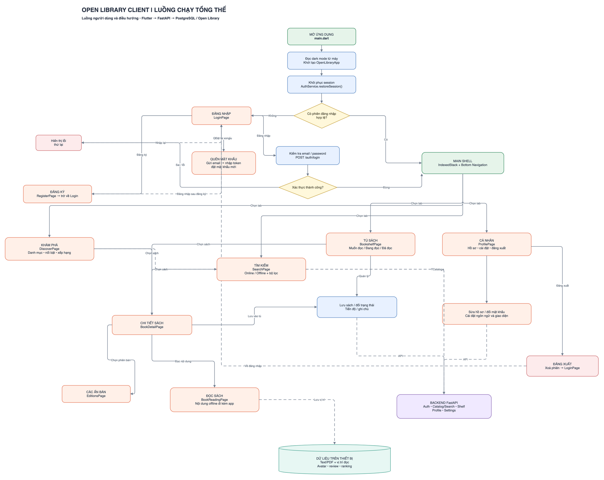
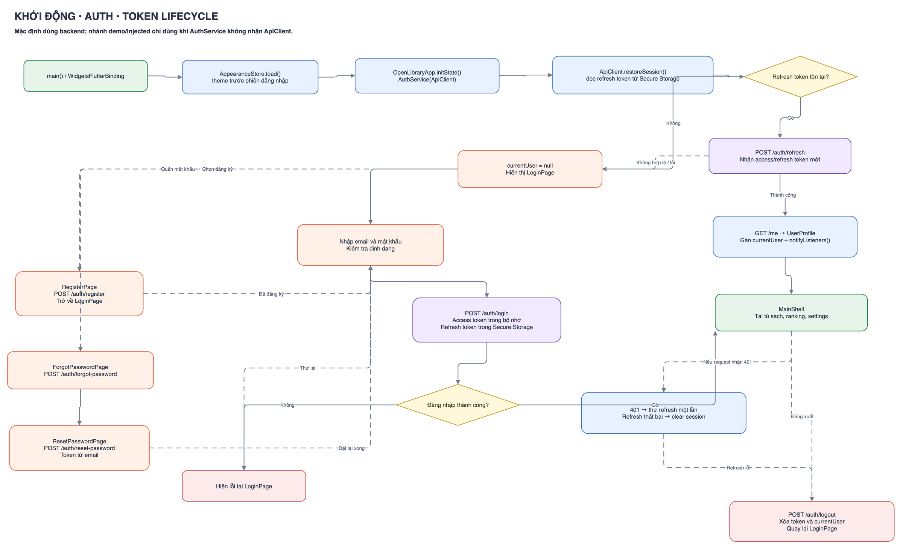
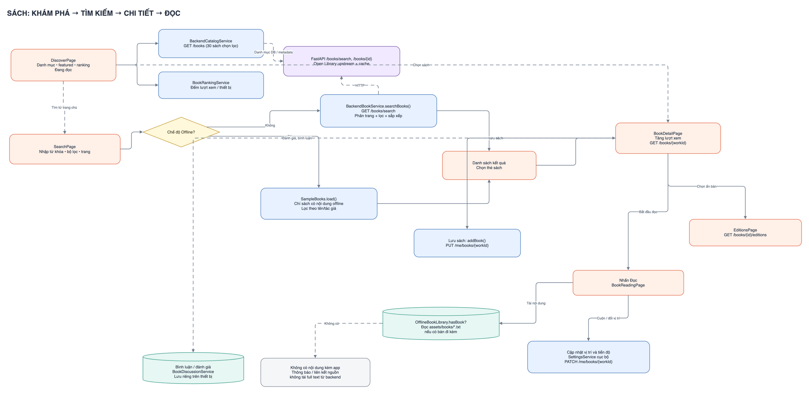
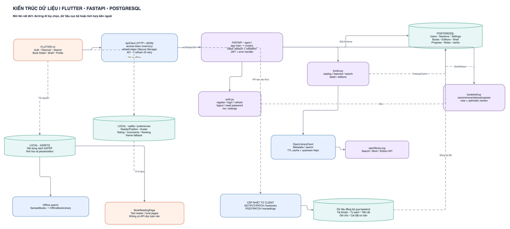
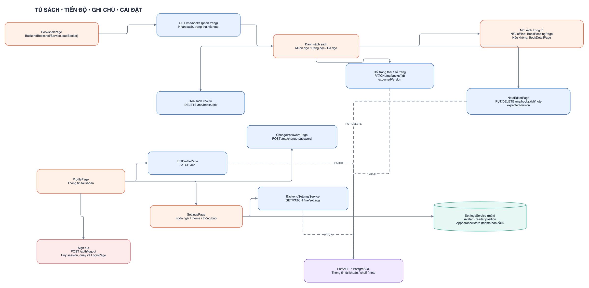

# Open Library Client

Ứng dụng Flutter để khám phá, tìm kiếm, lưu sách, đọc nội dung sẵn có và theo dõi tiến độ. Giao diện hỗ trợ tiếng Việt, tiếng Anh, chế độ sáng và tối.

## Sơ đồ luồng ứng dụng

Nhấn vào ảnh để xem kích thước đầy đủ.

### Luồng tổng thể

[](md/app-flow-01.png)

### Khởi động và xác thực

[](md/app-flow-02.png)

### Khám phá, tìm kiếm và đọc sách

[](md/app-flow-03.png)

### Backend và luồng dữ liệu

[](md/app-flow-04.png)

### Tủ sách và cá nhân

[](md/app-flow-05.png)

## Chạy với backend

Khởi động PostgreSQL và FastAPI theo [backend/README.md](backend/README.md). Sau đó, tại thư mục gốc:

```sh
flutter pub get
flutter run
```

Mặc định app dùng `http://127.0.0.1:8000/api/v1` trên iOS Simulator, macOS và web; Android Emulator dùng `http://10.0.2.2:8000/api/v1`. Khi chạy web, thêm origin của Flutter vào `CORS_ORIGINS` trong `backend/.env`. Với điện thoại thật hoặc máy chủ khác, cho FastAPI lắng nghe trên mạng phù hợp và truyền URL truy cập được từ điện thoại:

```sh
flutter run --dart-define=API_BASE_URL=http://<IP-máy-chạy-backend>:8000/api/v1
```

App dùng backend cho tài khoản, khôi phục phiên đăng nhập, hồ sơ, mật khẩu, cài đặt, danh mục, tìm kiếm trực tuyến, tủ sách, tiến độ và ghi chú. Refresh token được giữ trong secure storage của thiết bị. Chức năng quên mật khẩu ở môi trường phát triển ghi email vào `backend/.local/mail`; nhập mã trong email ở màn đặt lại mật khẩu.

Nội dung đọc có sẵn, vị trí đọc, ảnh đại diện, bình luận, đánh giá và xếp hạng vẫn ở thiết bị. Backend hiện chưa có API cho các phần này; chúng chưa đồng bộ giữa thiết bị. Tìm kiếm sách ngoại tuyến vẫn dùng dữ liệu kèm app.

Kiểm tra bằng `flutter analyze`, `flutter test` và `cd backend && .venv/bin/python -m pytest -q`.
